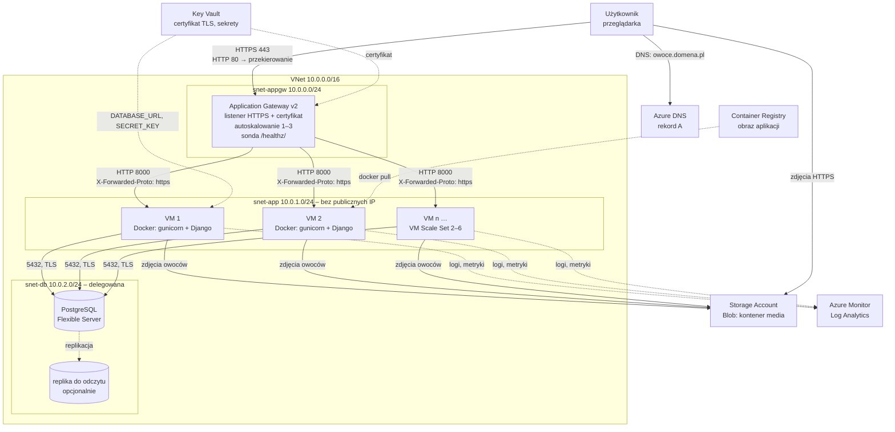

# L3 – Projekt architektury infrastruktury (chmura)

Aplikacja: **Owocownik** (Django 5.2, Python 3.12) – ranking owoców z logowaniem, ocenami i komentarzami.
Chmura: **Microsoft Azure** (region Poland Central, konto Azure for Students). Odpowiedniki w AWS – na końcu.

## Wymagania L3 i jak je spełniamy

| Wymaganie | Rozwiązanie |
|---|---|
| Load balancer (ze skalowaniem) | **Azure Application Gateway v2** (L7) przed **VM Scale Set** z autoskalowaniem 2–6 instancji; sam gateway też skaluje się automatycznie (1–3 jednostki) |
| Baza danych gotowa do skalowania | **Azure Database for PostgreSQL – Flexible Server**: jedna wspólna baza dla wszystkich instancji, skalowanie w górę (zmiana rozmiaru), auto-powiększanie dysku, repliki do odczytu, wbudowany PgBouncer |
| Domena publiczna | `owoce.<domena-grupy>.pl` – rekord **A** w strefie **Azure DNS** na publiczny IP gatewaya |
| Certyfikat SSL/TLS nie na serwerze aplikacji | Certyfikat w **Azure Key Vault**, podpięty do listenera HTTPS na Application Gateway; TLS kończy się na gatewayu, instancje dostają HTTP w sieci prywatnej |

## Schemat



## Komponenty

**Application Gateway v2 (load balancer L7)**
- Listener HTTPS :443 z certyfikatem z Key Vault (Let's Encrypt albo certyfikat od rejestratora domeny), TLS 1.2+.
- Listener HTTP :80 – tylko przekierowanie 301 na HTTPS.
- Pula backendu = VM Scale Set; reguła round-robin, **bez sticky sessions** (sesja jest w bazie, więc każda instancja obsłuży każdego użytkownika).
- Sonda zdrowia `GET /healthz/` co 10 s – instancja, która nie odpowie 200 (np. straciła połączenie z bazą), wypada z puli.
- Do backendu dopisuje `X-Forwarded-Proto: https` i `X-Forwarded-Host`, dzięki czemu Django wie, że użytkownik jest na HTTPS.
- W L7 ten sam gateway przełączamy na SKU **WAF_v2** (reguły OWASP), bez zmiany architektury.

**VM Scale Set (warstwa aplikacji)**
- Ubuntu 24.04 LTS, Docker, kontener z obrazem z Azure Container Registry (`Dockerfile` w repo): gunicorn, 3 workery, port 8000.
- Autoskalowanie: min. 2 instancje (dostępność przy awarii jednej), maks. 6; +1 instancja przy średnim CPU > 70% przez 5 min, −1 przy CPU < 30% przez 10 min.
- Instancje są **bezstanowe**: nie trzymają sesji, plików ani bazy – można je dodawać i usuwać w każdej chwili.
- Brak publicznych IP; administracja przez Azure Bastion albo Run Command.
- Sekrety (`DJANGO_SECRET_KEY`, `DATABASE_URL`, klucz Storage) z Key Vault przez Managed Identity, nie w obrazie ani w repo.

**Azure Database for PostgreSQL – Flexible Server (baza)**
- PostgreSQL 16, na start Burstable B1ms (tanio na studenckim koncie), dysk 32 GB z auto-powiększaniem.
- Skalowanie: pionowe (zmiana rozmiaru na General Purpose bez zmiany adresu), repliki do odczytu, wbudowany PgBouncer, gdy instancji aplikacji będzie dużo (pula połączeń). Opcjonalnie HA strefowe (zapasowy serwer w innej strefie).
- Dostęp prywatny (VNet integration, delegowana podsieć), połączenia tylko po TLS (`sslmode=require`).
- Kopie zapasowe automatyczne, 7 dni, przywracanie do punktu w czasie.
- Migracje schematu uruchamia jednorazowe zadanie przy wdrożeniu (`python manage.py migrate`), a nie każda instancja przy starcie.

**Storage Account – Blob (zdjęcia owoców)**
- Zdjęcia wgrywane w panelu admina trafiają do kontenera `media` (django-storages), więc są widoczne z każdej instancji. Kontener z publicznym odczytem pojedynczych plików (bez listowania); w L7 można przed niego dać CDN.

**Pozostałe**: Azure DNS (strefa domeny), Key Vault (certyfikat + sekrety), Container Registry (obrazy), Azure Monitor / Log Analytics (logi z stdout, metryki do autoskalowania i alertów).

## Sieć i reguły ruchu

| Podsieć | Adresy | Kto może wejść (NSG) |
|---|---|---|
| snet-appgw | 10.0.0.0/24 | Internet: 80, 443; Azure: 65200–65535 (wymagane przez Application Gateway v2) |
| snet-app | 10.0.1.0/24 | tylko snet-appgw → 8000 |
| snet-db | 10.0.2.0/24 | tylko snet-app → 5432 |

Z internetu dostępny jest wyłącznie Application Gateway (i Blob ze zdjęciami).

## Przepływy

1. **Żądanie**: przeglądarka → DNS → Application Gateway (TLS) → wolna, zdrowa instancja (HTTP) → PostgreSQL → odpowiedź. Zdjęcia przeglądarka pobiera prosto z Blob Storage.
2. **Skalowanie**: Azure Monitor widzi CPU > 70% → VM Scale Set tworzy nową VM → VM pobiera obraz z ACR i startuje kontener → sonda `/healthz/` zwraca 200 → gateway dokłada ją do puli.
3. **Wdrożenie** (szczegóły w L5): budowa obrazu → ACR → `migrate` jako jednorazowe zadanie → aktualizacja VM Scale Set po kolei (rolling upgrade), zawsze co najmniej jedna działająca instancja.

## Zmiany w aplikacji pod tę architekturę

| Zmiana | Plik | Dlaczego |
|---|---|---|
| Konfiguracja ze zmiennych środowiskowych (`DJANGO_DEBUG`, `DJANGO_SECRET_KEY`, `DJANGO_ALLOWED_HOSTS`, `DJANGO_CSRF_TRUSTED_ORIGINS`); bez klucza produkcja nie wstanie | `config/settings.py`, `.env.example` | ten sam obraz w każdym środowisku, sekrety poza repo |
| Baza z `DATABASE_URL` (PostgreSQL), bez niej SQLite | `config/settings.py` | SQLite to plik na jednej maszynie – nie da się go współdzielić między instancjami |
| `SECURE_PROXY_SSL_HEADER`, `USE_X_FORWARDED_HOST`, ciasteczka `Secure`, HSTS | `config/settings.py` | TLS kończy się na load balancerze, aplikacja musi wiedzieć, że użytkownik jest na HTTPS |
| Sonda `/healthz/` (sprawdza bazę, działa dla prywatnego IP spoza `ALLOWED_HOSTS`) | `fruits/health.py` | load balancer musi wiedzieć, które instancje są zdrowe |
| Zdjęcia w Azure Blob, zmniejszanie zdjęć w pamięci przed zapisem | `config/settings.py`, `fruits/models.py` | instancje nie mają wspólnego dysku; stary kod nadpisywał plik po ścieżce na dysku |
| Pliki statyczne przez WhiteNoise, budowane w obrazie | `config/settings.py`, `Dockerfile` | każda instancja ma komplet plików, bez osobnego serwera |
| Logi na stdout | `config/settings.py` | zbiera je Azure Monitor, a nie plik na VM, która może zniknąć |
| `Dockerfile` (gunicorn, użytkownik bez roota, bez migracji przy starcie) | `Dockerfile`, `.dockerignore` | jeden obraz uruchamiany przez VM Scale Set |
| Testy: sonda, nagłówek HTTPS z gatewaya, odrzucanie obcego hosta | `fruits/tests.py` | |

Sprawdzenie lokalne trybu produkcyjnego:
```powershell
$env:DJANGO_DEBUG="0"; $env:DJANGO_SECRET_KEY="<losowy>"; $env:DJANGO_ALLOWED_HOSTS="owoce.example.pl"
.\.venv\Scripts\python manage.py check --deploy
```
Zostają 3 ostrzeżenia celowo: `W008` (przekierowanie na HTTPS robi gateway) oraz `W005` / `W021` (HSTS dla subdomen i preload – do decyzji w L7/L8).

## Odpowiedniki w AWS (gdyby grupa wybrała AWS)

| Azure | AWS |
|---|---|
| Application Gateway v2 (+ WAF) | Application Load Balancer (+ AWS WAF) |
| VM Scale Set | EC2 Auto Scaling Group |
| PostgreSQL Flexible Server | RDS for PostgreSQL / Aurora |
| Blob Storage | S3 (`storages.backends.s3.S3Storage`) |
| Key Vault (certyfikat) | ACM (darmowy certyfikat na ALB) + Secrets Manager |
| Azure DNS | Route 53 |
| Container Registry | ECR |
| Azure Monitor | CloudWatch |
