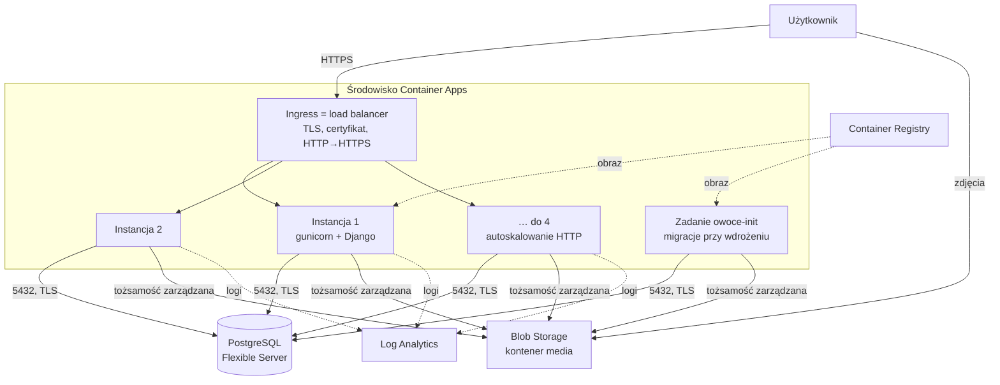

# Wdrożenie Owocownik w Azure (Azure Container Apps)

Aplikacja działa w **Azure Container Apps** z bazą **Azure Database for PostgreSQL – Flexible Server**.
Skrypty wdrożenia: [`deploy/azure/`](../deploy/azure/).

## Wymagania i jak są spełnione

| Wymaganie | Rozwiązanie |
|---|---|
| Load balancer (ze skalowaniem) | **Ingress Container Apps** – zarządzany load balancer (Envoy) rozkłada ruch na wszystkie instancje aplikacji. **Autoskalowanie HTTP**: min. 1, maks. 4 instancje, nowa instancja co 30 równoczesnych żądań (`deploy/azure/config.ps1`). |
| Baza danych gotowa do skalowania | **PostgreSQL Flexible Server**: jedna wspólna baza dla wszystkich instancji (sesje też są w bazie, więc load balancer nie potrzebuje „sticky sessions”). Skalowanie w górę bez zmiany adresu (B1ms → General Purpose), auto-powiększanie dysku, repliki do odczytu, wbudowany PgBouncer, opcjonalnie HA strefowe. |
| Domena publiczna | Teraz adres techniczny `https://owoce.<…>.azurecontainerapps.io`. Własna domena – krok 4: domena główna (np. `domena.pl`, opcjonalnie też `www.domena.pl`) przez rekord A na stały adres IP środowiska albo subdomena (np. `owoce.domena.pl`) przez rekord CNAME; w obu przypadkach + rekord TXT `asuid` potwierdzający własność domeny. |
| Certyfikat SSL/TLS nie na serwerze aplikacji | TLS kończy się na **ingressie** (load balancerze). Dla adresu technicznego certyfikat zapewnia Azure; dla własnej domeny – **darmowy certyfikat zarządzany przez Azure**, odnawiany automatycznie. Kontener z aplikacją dostaje zwykłe HTTP w sieci wewnętrznej i wie o HTTPS z nagłówka `X-Forwarded-Proto`. Ruch HTTP jest przekierowywany na HTTPS. |

## Schemat



## Różnica względem projektu L3

Projekt L3 (`docs/L3-architektura.md`) zakłada Application Gateway v2 + VM Scale Set. Do wdrożenia
wybraliśmy Container Apps, bo spełnia te same wymagania, a jest znacznie tańsze (sam Application Gateway
kosztuje ok. 180 USD/mies., czyli więcej niż cały kredyt Azure for Students) i prostsze w utrzymaniu.
Aplikacja jest ta sama – zmiany z L3 (zmienne środowiskowe, PostgreSQL, nagłówki proxy, `/healthz/`,
Blob Storage, Dockerfile) działają bez zmian w obu wariantach.

| Projekt L3 | Wdrożenie |
|---|---|
| Application Gateway v2 | Ingress Container Apps |
| VM Scale Set (autoskalowanie po CPU) | Repliki Container Apps (autoskalowanie po liczbie żądań) |
| Certyfikat w Key Vault na gatewayu | Certyfikat zarządzany przez Azure na ingressie |
| Sekrety w Key Vault | Sekrety Container Apps (szyfrowane, poza obrazem i repozytorium) |
| Klucz do Storage | Tożsamość zarządzana (bez klucza) |

## Koszty (orientacyjnie, region Poland Central)

| Zasób | Koszt / miesiąc |
|---|---|
| Container Apps (0,25 vCPU, 0,5 GB, 1 instancja stale) | ok. 5–15 USD (część w darmowej puli) |
| PostgreSQL Flexible B1ms + 32 GB | ok. 15–20 USD |
| Container Registry Basic | ok. 5 USD |
| Storage, Log Analytics | < 1–2 USD |

Razem ok. **25–40 USD/mies.**

**Pauza** (gdy aplikacja nie jest potrzebna): `powershell -ExecutionPolicy Bypass -File .\deploy\azure\pauza.ps1` – aplikacja schodzi do 0 instancji, baza zostaje zatrzymana, dane zostają; płaci się tylko za dysk bazy, rejestr i Storage (ok. 5–10 USD/mies.). Azure sam włącza zatrzymaną bazę po 7 dniach – przy dłuższej pauzie uruchom skrypt ponownie. **Wznowienie**: `.\deploy\azure\wznow.ps1` (ok. 5 min, na końcu sprawdza `/healthz/`).

Ręcznie: bazę można zatrzymać, gdy nie jest potrzebna (do 7 dni):
`az postgres flexible-server stop -g rg-owoce -n <nazwa>`. Usunięcie wszystkiego: `az group delete -n rg-owoce`.

## Wdrożenie krok po kroku

Wymagania: [Azure CLI](https://learn.microsoft.com/cli/azure/install-azure-cli-windows), uruchomiony **Docker Desktop** (obraz budujemy lokalnie – Azure for Students blokuje budowanie w chmurze przez `az acr build`), konto Azure (np. Azure for Students, dozwolone regiony m.in. Poland Central). Skrypty uruchamiamy przez `powershell -ExecutionPolicy Bypass -File <skrypt>`.

```powershell
az login                                   # logowanie w przeglądarce
.\deploy\azure\1-infrastruktura.ps1        # rejestr, obraz (Docker), Storage, środowisko, aplikacja, zadanie (~15 min)
.\deploy\azure\2-baza-i-sekrety.ps1        # PostgreSQL + losowe hasła jako sekrety (~10 min)
.\deploy\azure\3-wdrozenie.ps1 -SkipBuild  # migracje bazy i sprawdzenie /healthz/
```

Konto administratora aplikacji (hasło wpisujesz sam, w terminalu):

```powershell
az containerapp exec -g rg-owoce -n owoce --command "python manage.py createsuperuser"
```

Kolejne wdrożenia zmian w kodzie: `.\deploy\azure\3-wdrozenie.ps1` – buduje nowy obraz, uruchamia migracje
i podmienia instancje aplikacji bez przerwy w działaniu.

### Własna domena (krok 4)

```powershell
# domena główna + www (rekordy A i CNAME):
powershell -ExecutionPolicy Bypass -File .\deploy\azure\4-domena.ps1 -Domain twojadomena.pl -Www
# albo subdomena (rekord CNAME):
powershell -ExecutionPolicy Bypass -File .\deploy\azure\4-domena.ps1 -Domain owoce.twojadomena.pl
```

Skrypt wypisuje rekordy do dodania w panelu DNS rejestratora (np. home.pl → strefa DNS), sprawdza w publicznym DNS,
czy są już widoczne, a potem podpina domenę i zamawia darmowy certyfikat (domena główna – weryfikacja HTTP,
subdomena / www – weryfikacja CNAME) i dopisuje adresy do `DJANGO_ALLOWED_HOSTS`.

| | Domena główna (`twojadomena.pl`) | Subdomena (`owoce.twojadomena.pl`) |
|---|---|---|
| Rekord | **A** `@` → stały IP środowiska Container Apps | **CNAME** → adres aplikacji w Azure |
| Weryfikacja | TXT `asuid` | TXT `asuid.owoce` |
| Po usunięciu i ponownym postawieniu środowiska | **IP się zmienia** – trzeba poprawić rekord A | wystarczy ponownie uruchomić skrypt |

Przy domenie głównej usuń w panelu domyślne rekordy A/AAAA dla `@` (np. strona parkingowa rejestratora); rekordów
poczty (MX, TXT SPF) nie ruszaj. Pauza (`pauza.ps1`) nie zmienia adresu IP – środowisko zostaje.

### Poczta – reset hasła (krok 5)

Link „Nie pamiętasz hasła?” (ważny 1 godzinę) wysyłamy przez skrzynkę `kontakt@owocownik.pl` w home.pl (SMTP).
Nazwę serwera SMTP (`serwerXXXXXX.home.pl`) podaje panel home.pl przy konfiguracji programu pocztowego.

```powershell
powershell -ExecutionPolicy Bypass -File .\deploy\azure\5-poczta.ps1
```

Skrypt pyta o serwer i hasło do skrzynki (hasło trafia tylko do sekretu Container Apps `email-host-password`) i ustawia
zmienne `EMAIL_HOST`, `EMAIL_PORT` (465 = SSL), `EMAIL_HOST_USER`, `EMAIL_HOST_PASSWORD`, `DJANGO_DEFAULT_FROM_EMAIL`.
Bez `EMAIL_HOST` aplikacja nie wysyła maili – wiadomości lądują tylko w logach. Test wysyłki:
`az containerapp exec -g rg-owoce -n owoce --command "python manage.py sendtestemail twoj@adres.pl"`.

## Jak pokazać spełnienie wymagań

- **Load balancer i skalowanie**: portal → aplikacja `owoce` → *Scale* (reguła HTTP, 1–4 instancje) i *Revisions and replicas*
  (lista instancji). Test obciążenia, np. `hey -z 60s -c 100 https://<adres>/`, pokazuje dokładanie instancji.
- **Baza**: portal → `psql-owoce-…` → *Compute + storage* (zmiana rozmiaru, auto-powiększanie), *Replication* (repliki).
- **TLS poza aplikacją**: aplikacja w kontenerze słucha na HTTP :8000; certyfikat widać w przeglądarce
  i w portalu → *Custom domains* / *Certificates* środowiska.

## Region bazy

Subskrypcja Azure for Students często nie ma wolnych serwerów PostgreSQL w Poland Central (błąd `SkuNotAvailable`). Skrypt kroku 2 tworzy wtedy bazę w kolejnym dozwolonym regionie (Germany West Central, Switzerland North, Norway East, Spain Central), a nazwa serwera dostaje skrót regionu, np. `psql-owoce-fr7k2-gwc`. Aplikacja zostaje w Poland Central; baza w sąsiednim regionie dodaje kilkanaście ms opóźnienia na zapytanie.

## Bezpieczeństwo – świadome uproszczenia

- Baza ma publiczny adres z regułą „dostęp tylko z usług Azure” + TLS + losowe 32-znakowe hasło. Wersja docelowa:
  środowisko Container Apps w sieci wirtualnej (VNet) i baza z dostępem prywatnym (jak w L3).
- Kontener `media` pozwala czytać pojedyncze pliki po adresie (zdjęcia owoców są publiczne), ale nie listować zawartości.
- Brak WAF (Azure Front Door / Application Gateway WAF to ok. 35+ USD/mies.). Zamiast niego limit żądań w aplikacji
  (`fruits/ratelimit.py`): ogólny 600 żądań/min na IP (pamięć procesu) i limity formularzy we wspólnym cache
  w PostgreSQL (logowanie 10/5 min na konto, reset hasła 3/h na adres e-mail itd.). Adres klienta = ostatni wpis
  `X-Forwarded-For` dopisany przez ingress. Wyłączenie awaryjne: zmienna `DJANGO_RATELIMIT=0`.
